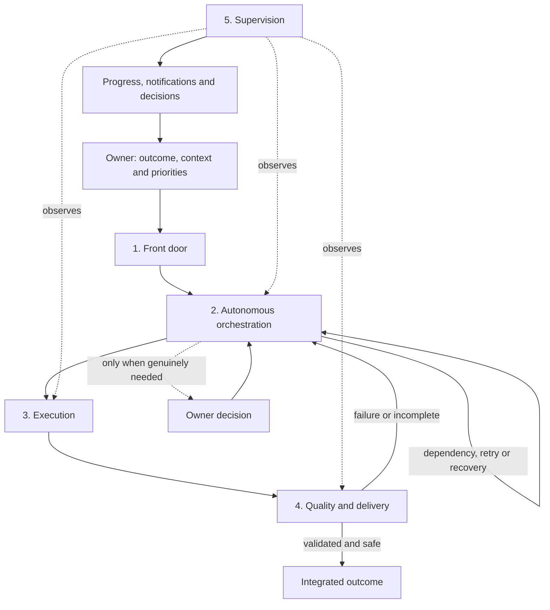
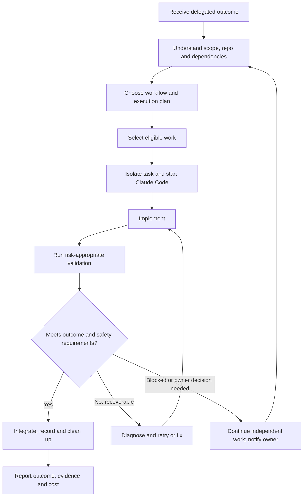

# OliverCode

OliverCode is a harness for Claude Code. An agent is the model plus its harness. OliverCode drives Claude Code headless, through the owner's signed-in subscription, with no API key and no per-token billing, and wraps each run in rounds that run the repo's own validation and feed failures back. It adds the shared instructions, skills, commit gates, fleet checks and checks that direct and check every session.

Every project gets the same rules, skills, templates and repository checks, and keeps its own code and local configuration.

What the harness covers today:

- `olivercode run` and `olivercode dispatch`: Claude Code headless on a task or a board story, with the repo's own validation between rounds
- `olivercode drain` and `olivercode land`: a repo's open stories worked in priority order, each rebased, validated and pushed to main
- Shared instructions, voice and design standards, and skills that install into `~/.claude`
- Commit and push gates that refuse unsafe or incomplete work, with checks that the gates still run in every fleet repo
- Fleet checks for layout, boards, ledgers, tests, research and machine health, plus scheduled jobs that groom boards, and sync repos with no model call
- A GitHub budget and a validation queue that every session shares
- A decision ledger that keeps the owner's exact words for each decision

Also in place: a check that policy cannot turn off silently, and a lessons log that `olivercode lesson add` appends to. Fresh-clone portability, second-device sync, honest token counts and a check for each lesson are tracked on the backlog.

## Install

Clone the public repository, or fork it on GitHub and clone your fork. For a copy with no history, run `python3 scripts/qa/leak_scan.py --release DIR` and use the single-commit copy it writes. Open the folder in Claude Code and say what you want, for example `Set this up for me.` Claude installs OliverCode, registers your repos and checks that the gates block.

Manual install:

```bash
mkdir -p ~/Developer/Repos && cd ~/Developer/Repos
git clone <repo-url-or-fork-url> OliverCode
cd OliverCode
python3 scripts/olivercode install
```

The install command builds the commit hooks from `core/hooks/`, links `CLAUDE.md`, `VOICE.md`, `DESIGN.md` and skills into `~/.claude`, installs the Claude Code hooks, and preserves backups of files it replaces. It is safe to run again.

Install also links its `CLAUDE.md` into every Claude Code session on the machine, and the agents it governs build and merge a story's changes without asking. Read `CLAUDE.md` and `docs/RULES.md` before you install it.

Read [`docs/SETUP.md`](docs/SETUP.md) for machine setup, restoration, removal and troubleshooting.

## How work runs

You work in Claude Code normally: exploration, strategic conversation, planning, debugging and paired coding remain interactive.

When you explicitly delegate an outcome, OliverCode takes responsibility for moving that work forward; the request becomes durable work on the appropriate repo's board, with scope and dependencies clarified as needed.

OliverCode selects and manages the execution path: isolated Claude Code sessions, useful parallel work, recovery, appropriate validation, safe integration and cleanup. Today, `olivercode dispatch N` and `olivercode drain REPO` are the explicit queue execution entry points.

The owner-facing status view reports what is running, waiting, blocked, failed or complete, and what needs your decision.

## How it works, in plain terms

Think of a professional kitchen. Claude Code is a talented chef who can cook anything. OliverCode is everything around the chef that makes a kitchen run: the order tickets, the recipe standards, the pass where every plate is checked and the health inspector. You are the owner. You say what you want, and you never stand at the stove.

| In the kitchen | In OliverCode | What it does |
|---|---|---|
| You tell the front desk what outcome you want | Owner-facing front door | Captures the outcome, context and priority; ordinary conversations stay interactive |
| The ticket rail | Durable work queue | Tracks delegated work, acceptance criteria, scope and real dependencies |
| The expediter | Autonomous orchestrator | Understands, plans, routes, prioritizes and coordinates work; chooses the execution path |
| A cook with a clean station | Isolated Claude Code session | Implements bounded work in its own environment; sessions can be coordinated or parallelized when useful |
| The right cook for the job | Workflow and model selection | Chooses a suitable execution strategy based on task scope, complexity and risk |
| The pass, where every plate is checked | Risk-proportional quality checks | Runs the checks the change warrants; failures can be diagnosed, repaired and revalidated |
| A second cook tastes when needed | Review | Adds independent review when risk or complexity justifies it |
| The plate goes out and the ticket is closed | Safe delivery | Integrates verified work, records evidence, cleans up and reports the outcome |
| The health code posted on the wall | Commit gates | No secrets, no personal data, and every change tied to a ticket |
| The safety lead | Safety and policy controls | Prevents unsafe actions, data loss, unapproved operations and runaway work |
| The suggestion box | The candidates list | Automatic checks drop ideas in, and nothing becomes a ticket until you pick it |
| The operations checklist | Background maintenance | Keeps the system healthy; optional automation must not obstruct ordinary work |
| The recipe binder every cook follows | Rules, voice and design files | Loaded into every session |
| The training manuals | Skills | How to audit, file a story, plan and diagnose a bug |
| Shared operating standards | Repository and fleet configuration | Applies consistent safeguards while allowing repo-specific workflows and validation |
| The incident log | Lessons and decisions | What went wrong, and what you decided |

A delegated task gets a bounded execution context; OliverCode remains responsible for coordinating the work, checking the result, recovering when safe, integrating it and reporting back.


## Target architecture: owner to outcome

OliverCode is an autonomous operator with a small owner interface. The owner supplies the outcome and direction; OliverCode handles the operational work in between. Its internal complexity earns its place by improving autonomy, reliability, speed and trust—not by exposing more commands or decisions to the owner.



| Layer | OliverCode owns |
|---|---|
| **1. Front door** | Accept ideas, bugs, features and priorities in natural language; preserve the distinction between interactive Claude Code conversation and explicit delegation |
| **2. Autonomous orchestration** | Understand intent, investigate scope, plan and decompose when useful, select repositories and workflows, manage dependencies and prioritize work |
| **3. Execution** | Start and manage isolated Claude Code sessions, choose appropriate parallelism, coordinate workers, resume or restart safely, and recover from routine failures |
| **4. Quality and delivery** | Choose checks proportional to risk, inspect results, fix and revalidate failures, review when warranted, integrate safely and clean up |
| **5. Supervision** | Track truthful state and progress, detect stalled or failed work, communicate meaningful updates, record outcomes and costs, and escalate only decisions that need the owner |

### The autonomous execution loop

This is the operating loop inside the orchestration and execution layers. It is a capability cycle, not a list of commands the owner must learn.



The loop should continue independently where it safely can: a blocked task should not stop unrelated work; a recoverable failure should trigger a bounded repair attempt; conflicting changes should be coordinated or escalated; and an unsafe or ambiguous action should pause for an owner decision. Interactive Claude Code remains first-class and is never silently converted into queued work.

### How we judge complexity

Keep planning, grooming, decomposition, recovery, supervision and notifications when they materially increase the chance of completing the owner's outcome without intervention. Simplify duplicated state, competing lifecycle owners, unnecessary model sessions, redundant checks and process that adds no reliability. Measure owner interventions, completion rate, recovery rate, time to outcome, unnecessary sessions, validation time and truthful reporting—not lines deleted.

These diagrams describe the target architecture; the workflow and command sections below describe the current shipped interface.

## Using it well

- Use interactive Claude Code for thinking and collaboration; delegate explicitly when you want OliverCode to take responsibility for execution
- Describe the outcome, constraints and what done looks like; OliverCode should handle the planning and task mechanics
- Let OliverCode determine scope, split work and identify dependencies when doing so improves the result
- Use `olivercode status` to see progress, blockers, completed work and decisions that need you
- Keep owner decisions for genuine trade-offs, permissions, production actions and ambiguous requirements
- Use the current `olivercode dispatch N` and `olivercode drain REPO` entry points for queued execution until the owner front door is fully implemented

## Dispatch planning

`olivercode dispatch --plan` reads each story's Files area, holds back stories that overlap and runs the rest in parallel, and sets the model by story size. A story with no Files area is refused until it gets one.

## Use it in a project

From a project directory:

```bash
python3 /path/to/OliverCode/scripts/olivercode bootstrap .
python3 /path/to/OliverCode/scripts/olivercode discover --root /path/to/your/repos --register
python3 /path/to/OliverCode/scripts/olivercode sync-hooks
```

`bootstrap` adds the managed project files, `discover --register` adds the repo to the fleet, and `sync-hooks` installs the current hooks in every registered repo and sets Git's `core.hooksPath`. The project declares its own validation command and keeps project-specific behavior in its own repository.

Check the installation and registered projects with:

```bash
python3 scripts/olivercode health
python3 scripts/olivercode conform
```

## Commands

`python3 scripts/olivercode --help` prints every command with its arguments, and `python3 scripts/olivercode guide` prints how work runs, the first steps and these same rows with one plain line per command, and `olivercode guide NAME` says what one command, gate, guard, scheduled job or skill does and where it lives. `docs/SETUP.md` ("Launcher commands") holds what the help line cannot say. The table below names each command once, by job.

| Job | Commands |
| --- | --- |
| Install and update | `olivercode install`, `olivercode uninstall`, `olivercode update`, `olivercode bootstrap`, `olivercode sync-hooks`, `olivercode place`, `olivercode clean`, `olivercode worktree`, `olivercode commit-check` |
| Check a machine or a repo | `olivercode health`, `olivercode status`, `olivercode status digest`, `olivercode status page`, `olivercode status publish`, `olivercode conform`, `olivercode maintain`, `olivercode limits` |
| Run and land work | `olivercode run`, `olivercode dispatch`, `olivercode drain`, `olivercode land`, `olivercode wip`, `olivercode validated`, `olivercode queue` |
| Version and docs | `olivercode version-cut`, `olivercode docs-check` |
| Backlog and boards | `olivercode backlog-setup`, `olivercode board groom`, `olivercode board sync`, `olivercode story`, `olivercode candidates`, `olivercode gh-limit`, `olivercode gated` |
| Owner and decisions | `olivercode owner`, `olivercode decisions` |
| Learning | `olivercode lesson` |
| Fleet and policy | `olivercode discover`, `olivercode init-fleet`, `olivercode fleet-sync`, `olivercode policy` |
| Orientation | `olivercode guide` |

The scheduled jobs (`board sync`, `fleet-sync`, `maintain`, `gh-limit`, `version-cut`) take `--schedule` to install a launchd job and `--unschedule` to remove it.

## Skills

Say what you want to Claude Code and the matching skill loads, for example "audit this". `python3 scripts/olivercode guide` lists every skill with the phrases that load it, and [`skills/INDEX.md`](skills/INDEX.md) is the catalog.

## What runs automatically

- Git runs the `.githooks` hooks on each commit while `core.hooksPath` points to it, and Claude Code runs the hooks `install` adds (`docs/RULES.md`, "Execution")
- `bash scripts/validate.sh` checks OliverCode's gates, documents, references and tests

Hooks enforce the rules that must block work. The standards and skills guide the rest. [`docs/GATES.md`](docs/GATES.md) lists each gate and its scope.

## Repository layout

| Path | Purpose |
| --- | --- |
| `CLAUDE.md` | Rules loaded in every Claude Code session |
| `core/hooks/` | Source for the generated repository hooks |
| `core/templates/project/` | Files copied into downstream projects |
| `skills/` | Reusable engineering and framework skills |
| `shared/` | Example registries and bootstrap data |
| `.githooks/` | OliverCode's own Git hooks |
| `.github/` | The framework CI workflow, paused while Actions billing is off |
| `.claude/` | The adoption skill link, so a fresh clone opened in Claude Code can set itself up |
| `.olivercode/` | This repo's permission policy (`olivercode policy init`) |
| `scripts/olivercode` | Command-line entry point |
| `scripts/lib/` | Command implementations and checks |
| `scripts/hooks/` | Claude Code hook implementations |
| `scripts/qa/` | Installation and gate rehearsals |
| `docs/` | Standards and reference documents, including `DESIGN.md` for visual work |
| `tests/` | Tests for the shipped checks and commands |
| `olivercode.local.example.json` | The example of this machine's `olivercode.local.json`, which is gitignored |
| `runtime/control-plane/` | Local control-plane state, gitignored and never pushed |
| `scratch/` | Local working files, gitignored. The board backups `backlog-setup` writes go to `backlog-backups/` in the repo's git directory |

## Using OliverCode in your own fork

Four things differ in a fork. This repository is public. Get the code by cloning it or by forking it on GitHub, then cloning your fork. `docs/backlog-config.json` names this repository's board and the `backlog` skill refuses it in any other checkout, so run `olivercode backlog-setup` to create your own. The README names this repository, so edit its issue links. Machine paths live in `olivercode.local.json`, which is gitignored: copy `olivercode.local.example.json` and fill it in. `bash scripts/qa/rehearse-install.sh` proves the install in a sandbox before you trust it.

## Documentation

| Document | Purpose |
| --- | --- |
| [`docs/SETUP.md`](docs/SETUP.md) | Setup, restoration, removal, commands and troubleshooting |
| [`docs/VERSIONING.md`](docs/VERSIONING.md) | What moves MAJOR, MINOR and PATCH, and the rules the daily version cut reads |
| [`docs/RULES.md`](docs/RULES.md) | Standing rules and project lifecycle |
| [`docs/CONTRACT.md`](docs/CONTRACT.md) | Required project shape and allowed differences |
| [`docs/GATES.md`](docs/GATES.md) | Gate list and enforcement scope |
| [`docs/VOICE.md`](docs/VOICE.md) | Writing rules loaded in every session |
| [`docs/DESIGN.md`](docs/DESIGN.md) | Design standard, read on visual work |
| [`docs/AUDIT-ACCEPTED.md`](docs/AUDIT-ACCEPTED.md) | Audit findings the owner accepted, each with its reason |
| [`docs/BACKLOG.md`](docs/BACKLOG.md) | Review marker for the live GitHub Project backlog |
| [`docs/SHARING.md`](docs/SHARING.md) | Whether the repository can be shared, and why |
| [`skills/INDEX.md`](skills/INDEX.md) | Included skill catalog |

## Status

`VERSION` holds the current version, MAJOR.MINOR.PATCH, cut once per day of activity as [`docs/VERSIONING.md`](docs/VERSIONING.md) describes, and `CHANGELOG.md` lists what each version changed. `olivercode health` still prints how many commits a checkout is behind upstream and what they are, and the `stable` tag marks the last commit the owner confirmed. It runs on macOS and Linux with `git`, `bash`, `python3` and `perl`, and `gh` with `jq` for the backlog scripts. `bash scripts/validate.sh` proves the gates, docs, references and tests in one run.

## License

MIT, in [`LICENSE`](LICENSE).
